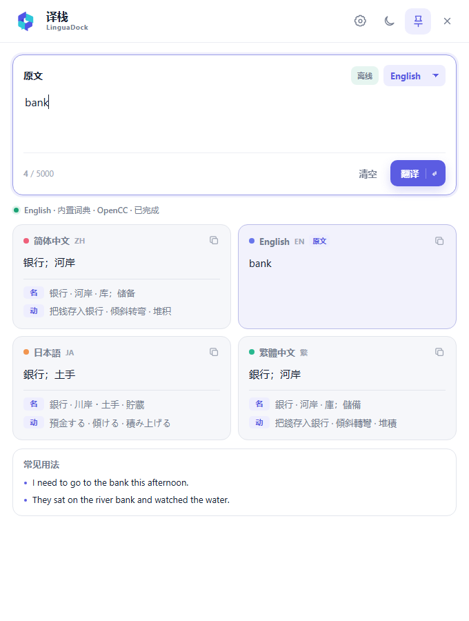

# Yizhan LinguaDock

LinguaDock (Chinese brand: **译栈**, “translation dock”) is a minimal, always-on-top Windows translation popup for four-way comparison between **Simplified Chinese, English, Japanese, and Traditional Chinese**.

Type in any one of the four languages. LinguaDock detects the source and shows all four versions at once. V1.0.2 adds offline translation, smart offline/online routing, and a custom AI API. Press `Ctrl + Alt + G` from any application to show the window; press it again to hide the window while the background tray process stays active.

[Download the latest release](https://github.com/PascalePaF/LinguaDock/releases/latest) · [中文说明](README.md) · [Offline engine guide](docs/offline-engines.md) · [Related-project research](docs/related-projects.md)



## V1.0.2 highlights

- **Smart, offline-only, and online-only** routing modes
- Four selectable offline engines:
  - bundled basic dictionary plus OpenCC for zero-setup words, phrases, and full Simplified/Traditional conversion
  - a local LibreTranslate server powered by Argos Translate
  - a local Ollama model
  - a locally loaded LM Studio model
- Configurable smart threshold: text at or below the limit stays offline; longer text uses the selected online engine
- Explicit, optional online fallback when an offline result is incomplete
- Google Translate or a custom OpenAI-compatible AI endpoint for online translation
- AI API keys stored in Windows Credential Manager, never in `localStorage` or a plain settings file
- `Enter` translates and `Ctrl + Enter` inserts a newline by default; the behavior can be swapped
- The global hotkey now toggles the window instead of only showing it
- New original “four conversation panes” visual identity while retaining the existing installer and updater identity

## Other features

- Four simultaneous results: Simplified Chinese, English, Japanese, and Traditional Chinese
- Automatic source detection with an optional manual override
- Parts of speech, concise meanings, and usage examples for supported single-word results
- Automatic translation after a short typing pause
- Custom 2–5 key global shortcut recording with conflict detection
- Optional launch at Windows sign-in, starting quietly in the system tray
- Automatic startup checks plus manual, signed in-app updates from GitHub Releases
- Frameless draggable window that adapts its dimensions to the content
- Persistent light and dark themes
- Click anywhere on a result card to copy its translation and meanings
- Always-on-top toggle, system tray, and single-instance behavior
- Installer and portable Windows builds
- No translation history, telemetry, ads, accounts, or project-owned relay server

## Download

Get the Windows x64 packages from [Releases](https://github.com/PascalePaF/LinguaDock/releases/latest):

- `LinguaDock_1.0.2_x64-setup.exe` — NSIS installer (recommended)
- `LinguaDock_1.0.2_windows_x64_portable.zip` — extract and run `LinguaDock.exe`
- `SHA256SUMS.txt` — published checksums

V1.0.1 and later can install V1.0.2 directly from **Settings → Update**. Moving the portable executable invalidates its saved autostart path, so the installer is recommended for regular use.

The public build is not commercially Authenticode-signed, so Windows SmartScreen may identify it as an unknown publisher. Download only from this repository and verify the SHA-256 checksums. In-app update packages are independently verified with Tauri’s updater signature.

## Default controls

| Action | Control |
| --- | --- |
| Show or hide from any app | `Ctrl + Alt + G` |
| Translate now | `Enter` |
| Insert a newline | `Ctrl + Enter` or `Shift + Enter` |
| Swap Enter behavior | Settings → General → Translation key |
| Hide to tray | `Esc` or the title-bar close button |
| Copy a result | Click anywhere on its result card |

## Privacy and routing

Offline-only mode never calls an online provider. Local service URLs are restricted to loopback addresses, private-network IPs, and `.local` hosts. Smart mode routes by character count and only uses online fallback when the visible fallback option is enabled.

Google mode sends submitted text and language codes to `translate.googleapis.com`. It uses a keyless endpoint used by the web client, not the supported, SLA-backed Google Cloud Translation API. AI API mode sends the text to the endpoint configured by the user. The API secret is stored in Windows Credential Manager.

See the [offline engine guide](docs/offline-engines.md) for setup requirements, trade-offs, and troubleshooting.

## Build from source

Requirements: Node.js 20.19+, Rust stable 1.88+, Microsoft C++ Build Tools, and WebView2 Runtime.

```powershell
npm ci
npm run check
npm run tauri -- build
```

The NSIS installer is created in `src-tauri/target/release/bundle/nsis/`.

Official release builds also require a Tauri updater signing key. GitHub Actions reads it from encrypted repository secrets and publishes the `.sig` file and `latest.json`; the private key is never committed.

See [CHANGELOG.md](CHANGELOG.md) for release details.

## License

[MIT](LICENSE)
